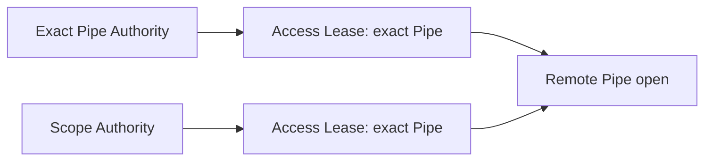
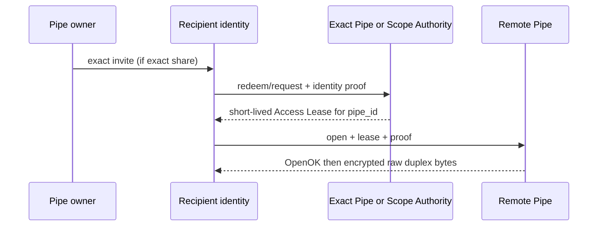
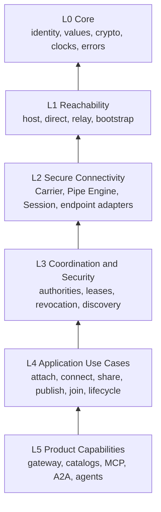

# Tubo high-level design

**Normative status:** This document defines future Tubo product and architecture. It stands independently of any implementation. [`ARCHITECTURE.md`](ARCHITECTURE.md) elaborates implementation boundaries. Existing prototype documents describe reference evidence where marked.

## 1. What is Tubo

Tubo is a secure peer-to-peer connectivity and collaboration platform.

```text
local service -> Tubo attach -> exact invite -> clean Tubo installation
              -> short-lived Access Lease -> authorized encrypted connectivity
```

Same primitives support scoped teams, signed Pipe discovery, private infrastructure, persistent connectivity, gateways, catalogs, MCP, A2A, agent discovery, capability search, and later integrations. Tubo is not primarily a VPN, reverse proxy, service mesh, or centralized tunnel broker.

## 2. Product principles

- Local services remain local unless deliberately exposed through a Pipe.
- Connectivity, discovery, and authorization are distinct concerns.
- Every network hop authorizes independently.
- Public infrastructure gives reachability, never ambient authority.
- Small coherent primitives compose; product features do not shortcut lower layers.
- A passing demo cannot excuse violated dependency boundaries.

## 3. Primary use cases

1. **A — Zero-config public exact share:** attach local service, send exact invite, recipient obtains lease and connects.
2. **B — Scoped collaboration over public infrastructure:** members publish and find Pipes, then obtain exact-Pipe leases.
3. **C — Private / hybrid infrastructure:** replace bootstrap/relay providers without changing Pipe, Session, authorization, or product semantics.
4. **D — Persistent service connectivity:** define durable Services and Pipes; run or supervise them; survive process restart/address change where supported; observe runtime, authorization, path, degradation, and recovery state without redefining resource.
5. **E — Higher-level capability discovery:** locate descriptor, resolve referenced Pipe, obtain lease, open Session.

## 4. User mental model

| Concept | Meaning |
|---|---|
| Service | Local application endpoint: HTTP, TCP, Unix socket. Not automatically discoverable. |
| Pipe | Stable directed connectivity resource: `Ingress -> Pipe -> Target`. Target is one Service or Pipe. |
| Session | Concrete active traversal of one or more Pipes. Owns live byte flow and continuity. |
| Identity | Stable cryptographic participant/resource-owner identity. |
| Scope | Optional collaboration, coordination, and security domain: membership, policy, publishing, discovery, revocation. Not connectivity definition. |
| Invite | Exact bootstrap/redemption credential. Not tunnel credential. |
| Access Lease | Short-lived cryptographic authorization to open one exact remote Pipe. |
| Descriptor | Higher-level discoverable metadata, such as AgentDescriptor, referencing a Pipe. |

Pipe composition is first-class. `attach` and `connect` are application-use-case presets, not runtime kinds. A2A and MCP are product capabilities; HTTP use does not make them Service transport kinds.

## 5. Core security invariant

> **Every remote Pipe open requires a short-lived, cryptographically verifiable Access Lease.**

Pipe ID, endpoint, PipeRecord, relay route, invite, or membership token alone do not authorize opening. Receiving/server boundary requires successful authorization result before local target open. Its L3 implementation validates lease signature, subject/proof, exact Pipe audience, expiry, revocation, authorization epoch, and required revocation-state availability. Any failure closes access.

```text
identified Pipe + reachable carrier + no valid Access Lease = denied
```

Connectivity depends on authorization. Connectivity must not depend directly on Scope topology.

## 6. Authorization domains

Two issuer topologies emit one connectivity primitive:



- **Exact Pipe Authority:** Pipe owner issues exact invite. Recipient redeems with identity proof and receives short-lived lease bound to exact Pipe.
- **Scope Authority:** membership and policy cause Scope Authority to issue same short-lived exact-Pipe lease.

### L2/L3 authorization boundary

L2 owns receiving-boundary enforcement, consumer-side open-authorization contract, and minimal authorization result needed to continue connectivity. L3 owns authority implementations; lease decoding and cryptographic validation; issuer trust; revocation; authorization epochs; membership/policy evaluation; and refresh semantics.

```text
L2 Pipe receiver -> OpenAuthorizer contract <- L3 implementation
```

A conceptual contract may resemble `AuthorizeOpen(ctx, OpenRequest) (Authorization, error)`. Contract is owned with L2 consumer need or in lower neutral contract location. L3 may implement it; L2 must not import concrete L3 authority/revocation implementations. Receiving-boundary enforcement means L2 invokes contract and opens local target only after success, not that authority implementation belongs inside Secure Connectivity. No successful authorization result means no local target open.

Step 6A (#48, implemented) introduces the neutral receiving-boundary seam only: L2 serve consumes an injected consumer-side OpenAuthorizer and opens no local target before success; current prototype Scope-token validation is preserved fail-closed behind a TRANSITIONAL adapter that #49 (6B, open) replaces with the canonical Scope-independent exact-Pipe Access Lease + Exact Pipe Authority. No prototype Token is renamed or wrapped as the target Access Lease contract.

Session and tunnel layers consume authorization result only. They must not encode public-versus-scope mode branches. Forwarding still requires independently authorized downstream open and explicit forward authority.

## 7. Invite and lease flow



Invite bootstraps redemption. Lease authorizes remote open. Never substitute one for other.

## 8. Infrastructure compositions

| Composition | Uses | Does not require |
|---|---|---|
| Zero-config public share | Signed Tubo public bootstrap bundle, public relay/bootstrap, direct path when possible, relay fallback, Exact Pipe Authority, exact invite | Scope, namespace, discovery, membership, user-configured authority |
| Scoped collaboration on public infrastructure | Same optional public reachability, Scope Authority, membership, scoped discovery/policy | Public infrastructure as authority |
| Private infrastructure | Operator bootstrap/relay providers, either authority topology | Changed upper layers |
| Hybrid | Any safe combination | Special architecture branch |

Public bootstrap bundle is foundation concern, separate from advanced gossip. A0 provides minimal real public path: signed bundle contract; embedded/preinstalled bundle verification; initial public relay/bootstrap identities and addresses including `relay.tubo.click`; version, validity, and signature semantics that fail closed; and zero-config reachability resolution. Journey A may not rely on final hardcoded or temporary-provider shortcut.

A2 evolves foundation: operator/private providers, public/private/hybrid composition, richer provider substitution, trust-root rotation, bundle/key-rotation lifecycle, private bootstrap, and justified operational/provider policy. Encrypted gossip, peer sync, and discovery-key rotation remain separate later concerns. Bundle never conveys cluster membership, Scope authorization, or ambient private-scope trust.

## 9. Discovery model

```text
Discovery:     how resource is found
Connectivity:  how identified resource is reached
Authorization: may caller open it
```

Exact invites bypass discovery. Scoped path is:

```text
scoped discovery -> signed PipeRecord -> exact Pipe endpoint
                 -> Access Lease -> normal connectivity
```

PipeRecord carries bounded network/routing/connectivity metadata only. It does not become arbitrary application metadata. Descriptor search is separate:

```text
capability search -> AgentDescriptor -> Pipe reference -> Pipe resolution
                  -> Access Lease -> Session
```

Secret discovery topics give name opacity, not traffic invisibility, anonymity, or complete metadata confidentiality.

## 10. Layered architecture



Dependencies point downward only. Layers are semantic/dependency rules, not package tree prescription.

- **L0:** no network or persistence I/O.
- **L1:** obtain carrier to peer. Does not decide Pipe access.
- **L2:** Service adapters, Pipe graph/Engine, Session, Carrier, forwarding, bytes, migration/recovery, endpoint resolution, handshake integration, and receiving-boundary enforcement through consumer-side/neutral open-authorization contract. Every remote open requires successful authorization result before local target open. No concrete L3 authority/revocation implementation, Scope membership, discovery policy, or application semantics.
- **L3:** Exact Pipe Authority, Scope Authority, authority implementations, lease decoding/cryptographic validation, issuer trust, membership/policy, publish/access leases, refresh, revocation/epochs, discovery, record validation, scoped views.
- **L4:** use cases with CLI/API/UI/automation as adapters.
- **L5:** higher product capabilities consume lower stable contracts.

## 11. Pipe Engine

Pipe Engine realizes directed graph `Ingress -> Pipe -> Target`. It resolves local Service or another Pipe, rejects loops, applies hop limits, and hands live traversal to Session. It knows endpoint and byte-flow semantics, not discovery or membership policy. A Pipe-to-Pipe hop performs new authorization at receiving boundary.

## 12. Reachability

Reachability owns node/host integration, direct dialing, hole punching, relay fallback/selection, bootstrap, and public/private provider adapters. Its output is a carrier to an identified peer. It never grants access and must work unchanged for exact, scoped, public, private, and hybrid compositions.

## 13. Runtime ownership

```text
NodeRuntime -> PipeRuntime(s) -> SessionRegistry -> Session(s)
```

Ownership is explicit. No package-global mutable runtime registries or process-global Session dispatch. Stream handlers receive or inherit owning runtime/context. Lifecycle, cancellation, session lookup, and cleanup follow ownership tree.

## 14. Persistence

One embedded SQLite database may remain transactional metadata store. No multiple databases, ORM, repository-per-table, or generic persistence framework required. Consumers define narrow capabilities near use:

```text
ServiceRepository, PipeRepository, RecordRepository,
RevocationRepository, Session/Event persistence
```

Persistence is adapter, not domain model. Core and runtime contracts do not broadly expose concrete `*store.Store`.

## 15. Application/use-case layer

Use cases coordinate lower capabilities: attach, connect, share, publish, join, start, stop, inspect. CLI is parsing/presentation adapter; it does not directly assemble host, persistence, authority, discovery, and session implementation details.

## 16. Extensibility

Generalize only after second real consumer. Do not build generic resource frameworks, universal plugin systems, `map[string]any` capability schemas, god ports packages, or abstractions without demonstrated pressure. MCP, A2A, catalog, gateway, and agents remain L5 consumers.

## 17. Security, observability, testing

Bound decoders before allocation. Use authenticated open handshake then raw full-duplex bytes. Preserve half-close and prohibit application-byte replay after successful open/re-resolution failure. Persist mutations fail closed. Observability distinguishes logical, authorization, and transport paths without exposing local Service targets or secrets.

Architecture test work includes component contracts, in-process integration, CLI contracts, distributed proof, and allowed/forbidden dependency-edge checks. Initial check mechanism: `go list -deps` plus small deterministic script. Do not add fake checks before A0 creates real boundaries.

## 18. Architecture acceptance journeys

- **A: zero-config public exact share.** Clean A attaches HTTP and produces invite. Clean B connects. Real traffic works. A0 verifies embedded/preinstalled signed public bundle and resolves initial `relay.tubo.click` reachability; no hardcoded/temporary final provider, Scope, membership, discovery, or user authority. Remote open uses lease.
- **B: scoped collaboration on public infrastructure.** Members join, publish/discover, receive Scope Authority lease, connect. Public reachability stays non-authoritative. L1/L2 need little or no redesign from A.
- **C: private / hybrid infrastructure.** Operator relay/bootstrap replaces or supplements public providers. Above L1 remains essentially unchanged.
- **D: persistent service connectivity.** Durable Service/Pipe definition stays distinct from PipeRuntime and transient Session. Users run/supervise resources, retain identity across supported restart/address change, and observe runtime, authorization, path, degradation, and recovery without redefining resource. A0 establishes separation/ownership/persistence foundation; later phases may add richer recovery behavior.
- **E: higher-level capability.** Search AgentDescriptor/capability, resolve Pipe reference, receive lease, open Session. A2A/agent discovery changes neither Session nor transport semantics.

See [`../testing/ARCHITECTURE_ACCEPTANCE.md`](../testing/ARCHITECTURE_ACCEPTANCE.md).

## 19. Implementation roadmap

- **A0:** establish real layer boundaries, explicit runtime ownership, Carrier/Session, Reachability, Pipe Engine, topology-independent authorization boundary, minimal signed public bootstrap foundation, persistence ports, use cases, durable-resource/transient-runtime separation; prove Journey A and foundations for D.
- **A1:** scoped collaboration and Scope Authority on unchanged A0 connectivity.
- **A2:** generalize public/private bootstrap and relay providers, hybrid composition, and rotation lifecycle.
- **A3:** descriptors, catalog, capability search; application metadata stays outside PipeRecord.
- **A4:** A2A and agent discovery above catalog/discovery/authorization/connectivity.

Full criteria: [`../implementation/ROADMAP.md`](../implementation/ROADMAP.md).

## 20. Open design decisions

A0 must decide concrete package topology only after boundaries are proven; precise Carrier API; exact consumer-side/neutral open-authorization contract and authorization result; exact L3 lease-verifier/revocation freshness contract; minimal preinstalled public-bundle trust root; Exact Pipe Authority lifecycle; and initial dependency-edge allowlist. A2 decides broader provider substitution and trust-root/bundle/key rotation lifecycle. No decision here authorizes compatibility shim or speculative framework.

## 21. Non-goals and decision summary

Not goals: prototype API compatibility, mandatory daemon, ambient authorization, Service discovery, public infrastructure authority, application metadata in PipeRecord, or a package per layer. Design target: authorized encrypted peer connectivity expressed through composable Pipes and Sessions, with optional coordination layered above it.
